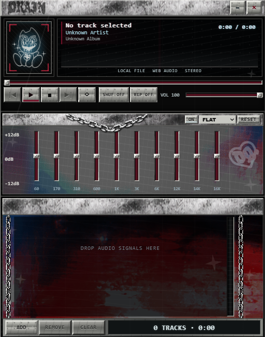

# Drainamp

A local desktop music player inspired by classic Winamp skins and
internet-grunge artwork.



## Download

[Download the latest Windows release](https://github.com/EnRangel/draingang-winamp/releases/latest)

Drainamp currently ships as a 64-bit Windows installer. Open the release page,
expand **Assets**, and download `Drainamp-1.0.0 Setup.exe`.

Windows may display an **Unknown publisher** warning because the installer is
not code-signed yet. Only install copies downloaded from the official release
page linked above.

## Features

- Plays local MP3, WAV, OGG, M4A, and FLAC files.
- Reads song metadata and embedded album artwork.
- Remembers imported tracks between launches.
- Skips missing saved tracks and displays a warning instead of crashing.
- Includes play, pause, seek, previous, next, shuffle, repeat, volume, and mute
  controls.
- Provides an independent 10-band equalizer with presets.
- Includes a live audio visualizer and audio-reactive panel backgrounds.
- Supports double-click playback and keyboard controls.
- Uses a custom frameless, dirty-silver interface inspired by classic Winamp
  skins.

Drainamp plays files directly from your computer. It does not upload your music
or require an account.

## Keyboard controls

| Key           | Action                             |
| ------------- | ---------------------------------- |
| `Space`       | Play or pause                      |
| `Left Arrow`  | Seek backward five seconds         |
| `Right Arrow` | Seek forward five seconds          |
| `Delete`      | Remove the selected playlist track |

Keyboard shortcuts pause while an input, slider, button, or preset menu has
focus. This lets those controls keep their normal keyboard behavior.

## Run the project locally

Install [Node.js](https://nodejs.org/) and Git, then run these commands in
PowerShell:

```powershell
# Download the source code from GitHub.
git clone https://github.com/EnRangel/draingang-winamp.git

# Enter the downloaded project folder.
cd draingang-winamp

# Install the exact project dependencies listed in package-lock.json.
npm install

# Build the development files and open Drainamp.
npm start
```

## Development commands

| Command              | Purpose                                             |
| -------------------- | --------------------------------------------------- |
| `npm start`          | Start Drainamp in development mode                  |
| `npm run typecheck`  | Check TypeScript types without creating build files |
| `npm run lint`       | Check the code and formatting rules                 |
| `npm test`           | Run the automated test suite once                   |
| `npm run test:watch` | Rerun relevant tests while files change             |
| `npm run icon:build` | Rebuild the Windows icon from the Drain Baby image  |
| `npm run make`       | Build the Windows installer and release files       |

After `npm run make`, the installer is created inside
`out/make/squirrel.windows/x64/`.

## Project structure

- `src/main.ts` creates and manages the Electron desktop window.
- `src/preload.ts` safely exposes only the allowed file and window actions to
  React.
- `src/App.tsx` coordinates playback, the playlist, and player settings.
- `src/components/` contains the three player panels and window controls.
- `src/audioEngine.ts` builds the visualizer and 10-band audio filter chain.
- `src/playlistStorage.ts` saves the playlist's permanent file references.
- `src/index.css` contains the Winamp-inspired skin and animations.
- `scripts/create-windows-icon.ps1` creates the application and installer icon.

The React interface does not receive unrestricted Electron or Node.js access.
Actions that need desktop access travel through the limited preload API and
Electron IPC handlers.

## Inspiration

Drainamp draws from internet-grunge artwork, classic desktop media players, and
the visual worlds surrounding Bladee, Ecco2k, Thaiboy Digital, Yung Lean, Drain
Gang, and Sad Boys. It combines those influences with an
original interactive music-player interface rather than presenting itself as
an official artist product.

## Disclaimer

Drainamp is an independent, unofficial fan project made for learning and is not
affiliated with or endorsed by Winamp, Bladee, Drain Gang, Yung Lean, or their
associated rights holders. Third-party names, logos, music, and artwork remain
the property of their respective owners.

## License

The source code is available under the [MIT License](LICENSE). The license does
not grant rights to third-party names, logos, music, or artwork.
